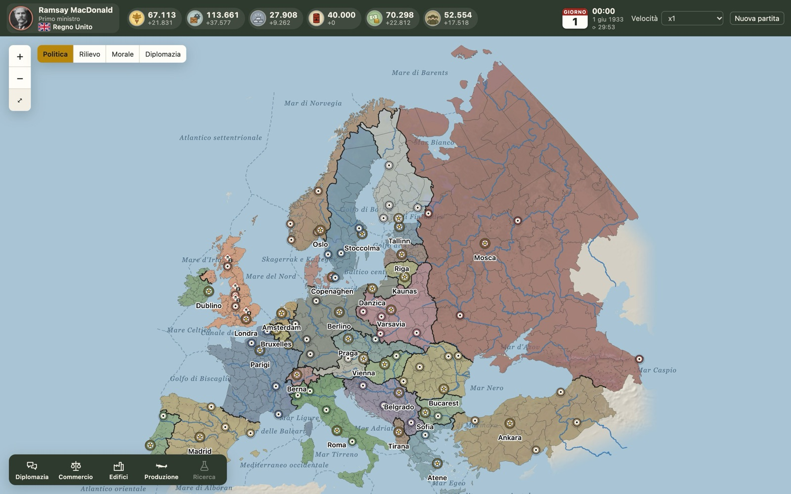
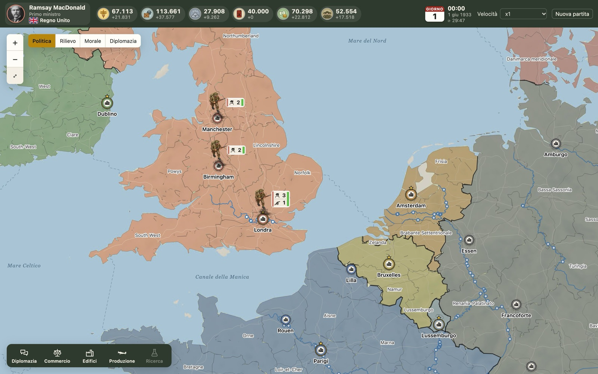
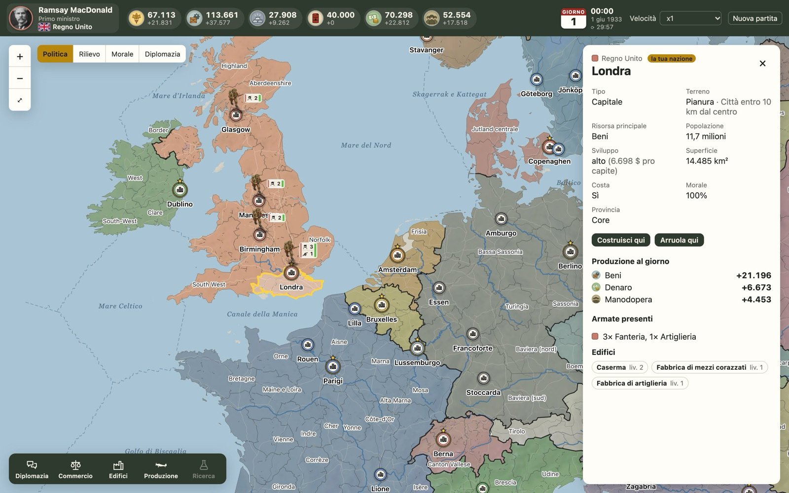

# 1940 World at War

*English · [Italiano](README.it.md)*

A real-time grand strategy game set in the Second World War, played in the browser. Each player leads a nation on a map of Europe as it was in June 1933 and manages its economy, buildings, armies, air force and navy, diplomacy, trade and fog of war. Games are persistent: they last days or weeks, and players check in a few times a day.

It is a hobby project, built to play with a small group of friends. **No in-game purchases and no way to pay to get ahead.**

**▶ Play the demo:** <https://delleroselorenzo-oss.github.io/1940-world-at-war/> (single player, runs entirely in your browser; the interface is in Italian)



| | |
|---|---|
|  |  |
| Armies are painted miniatures that stand on the map, with a tag showing troops and health. | Every province has its own population, resources, buildings and morale. |

## What is in it

- **A map built from real data**: about 360 provinces cut from 1933 borders, terrain computed from elevation and land cover, rivers, roads, railways, 30 sea zones and straits.
- **Economy**: food, goods, metal, oil, money and manpower, produced by provinces according to their 1933 population and level of development; oil only from real oil fields, a foreign market and synthetic fuel.
- **Land warfare**: armies move along roads and railways with real travel times. Combat is automatic and deterministic, with no dice. There are ranged artillery, terrain effects, morale, conquest and revolts, plus engineers who build bridges, fortifications, airfields and ports.
- **Air and sea**: squadrons with range and refuelling, air strikes and anti-aircraft fire. At sea there are fleets, submarines and detection, troop transports and amphibious landings, naval blockades, and merchant convoys that can be sunk.
- **Diplomacy and trade**: war, peace, truces, shared maps, right of passage, alliances, embargoes, chat, and a market where nations trade with each other.
- **Fog of war**, and map modes for politics, terrain, morale and diplomacy.
- **Historical leaders** for every nation from 1933 to 1945, and period photos for every unit, shown as they are, without retouching.

## How it is built

TypeScript monorepo:

```
client/   interface (React) and map rendering (PixiJS)
shared/   game engine: rules, balance data and the movement network, written as pure functions with unit tests
data/     map data and the scripts that build it from public geographic datasets
server/   multiplayer server (next milestone)
docs/     game design, guides, image credits
```

- **Deterministic engine.** `advance(state, world, minutes)` processes events in time order. Catching up on many hours at once gives exactly the same result as playing them step by step, and tests check this. The future server will be the single source of truth: clients only send orders, which `shared/src/game/orders.ts` validates.
- **Pathfinding.** A* over a 0.1° grid combined with the road and rail networks; rivers can only be crossed on bridges, and the sea has its own router.
- **Map pipeline.** Scripts in `data/scripts/` build provinces, terrain, the movement network and the relief map from CShapes, Natural Earth, elevation tiles and MODIS land cover.
- **Tests.** 212 unit tests (Vitest) cover the engine, the movement network and the map logic.

The game design, the balance values and the decisions taken are written down in [docs/game-design.md](docs/game-design.md). The roadmap is in [CLAUDE.md](CLAUDE.md), in Italian.

### Built with AI assistance

I designed and directed the project: the game design and balance, the historical research, the art direction and the architecture decisions. Most of the code was written with [Claude Code](https://claude.com/claude-code), Anthropic's AI coding assistant, which is why most commits are co-authored. The painted tokens were generated with an image model from prompts kept in [docs/pedine.md](docs/pedine.md).

## Running it locally

Requires Node.js 24.

```bash
npm install
npm run dev        # http://localhost:5173
npm test           # unit tests
npm run typecheck  # TypeScript
```

## Status

Playable in single player: the other nations stay idle for now, and bots only answer diplomatic proposals. The game is saved in the browser. Next up: the multiplayer server, research, generals and historical events.

## Licences

- **Code**: [GNU AGPL 3.0](LICENSE).
- **Map data** (`data/maps/`): derived from CShapes 2.0 and licensed under **CC BY-NC-SA 4.0**, for non-commercial use only. All sources are listed in the [map README](data/maps/europe-1933/README.md).
- **Historical photos and portraits**: from Wikimedia Commons, either public domain or under Creative Commons licences. The source, author and licence of every image are listed in [docs/crediti/](docs/crediti/).
- **Painted tokens and resource icons**: made for this project.
